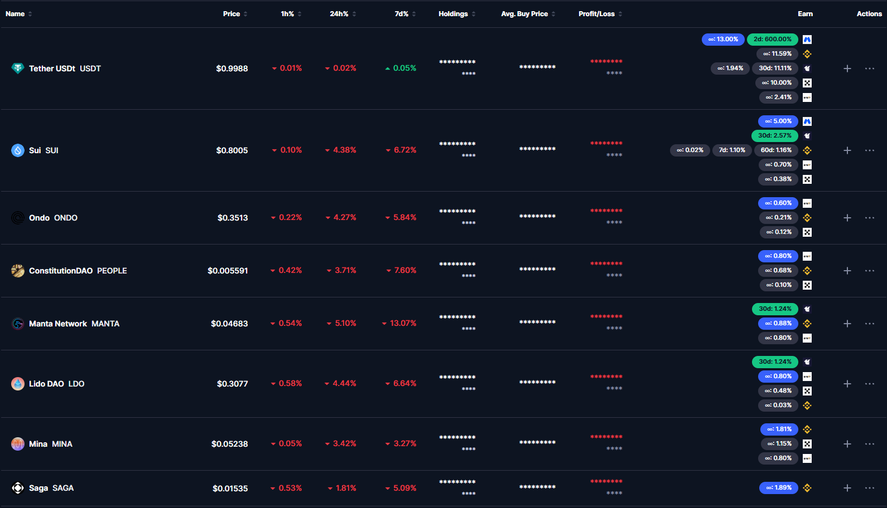

# 📘 CoinMarketCap Helper

---

## 🌟 Overview

This extension enhances the CoinMarketCap **Portfolio** page by fetching real-time **earn / staking APR** rates
from several exchanges for every coin in your portfolio and showing them right in the portfolio table.

It can also watch those rates in the background and message you in **Telegram** when a better rate shows up.

---

## ✨ Key Features
- 💰 **Multi-exchange support** — **Binance**, **Bybit**, **OKX**, **MEXC** and **WhiteBIT**.
- ⏳ **Flexible and fixed-term rates** — each rate is shown with its term: `∞` for flexible (redeem any time),
  `7d`, `30d`… for fixed-term products (up to 60 days on Binance and WhiteBIT).
- 🏆 **Best offer first** — exchanges are sorted by their best rate; the best flexible rate is highlighted in blue,
  the best fixed-term rate in green.
- 📊 **Portfolio totals** — a banner at the top of the portfolio page with net invested, current value and all-time
  profit/loss across all your portfolios, on every portfolio page. Net invested = value − profit/loss, so money
  moved between coins through swaps isn't counted twice (unlike CoinMarketCap's cost basis). Portfolios that
  aren't investments (e.g. savings) can be unchecked in the settings. Amounts stay hidden
  when you hide balances in CoinMarketCap.
- 🔔 **Telegram alerts** — get a message when the best rate for one of your coins goes up.
- ⚡ **No login, no API keys** — only public / website endpoints are used.
- 🔒 **Private** — everything runs locally in your browser; nothing is sent anywhere except to the exchanges and,
  if you set it up, your own Telegram bot.

---

## 💡 Example


---

## 🧩 Installation

1. Download the latest release (`coinmarketcap-helper@vX.Y.Z.zip`) from the [releases page](https://github.com/v3il/coinmarketcap-helper/releases).
2. Unzip the archive to any directory.
3. Open the Chrome extensions page: [chrome://extensions/](chrome://extensions/).
4. Enable **Developer mode** (toggle in the top right corner).
5. Click **"Load unpacked"**, then select the directory where you extracted the extension.

To update, unzip the new release over the old directory and press the reload button on the extension's card.

---

## 🔔 Telegram alerts

While Chrome is running, the extension checks rates in the background (every 4 hours by default) and messages you
when the best rate for a coin in your portfolio grows by at least 1 percentage point (configurable).

1. Create a bot with [@BotFather](https://t.me/BotFather) and copy its token.
2. Click the extension icon to open the settings and paste the token.
3. Send `/start` to your bot, then press **Find** to fill in the chat id.
4. Press **Send test message** to check the connection, then **Save**.
5. Open your portfolio on CoinMarketCap, so the extension learns which coins to watch. The list refreshes every
   time you open the portfolio; coins you haven't seen there for 30 days are dropped.

The first check only records the current rates; alerts come when a rate goes up after that.
The bot token is stored only in this browser's local extension storage.

---

## 🛠️ Development

```bash
npm install
npm run dev      # Chrome with the extension loaded and hot reload
npm run build    # production build into .output/chrome-mv3
npm run lint && npm run compile
```

- `lib/exchanges/` — one module per exchange. Each exports an `Exchange` (`id`, `name`, `logoUrl`, `loadRates()`)
  whose `loadRates()` returns `Map<symbol, { apr, days }[]>` (`days: 0` = flexible). To add an exchange, create
  a module, list it in `lib/exchanges/index.ts` and add its API host to `host_permissions` in `wxt.config.ts`.
- `entrypoints/content/` — renders the Earn column on the CMC portfolio page.
- `entrypoints/background.ts` — proxies requests for the content script and runs the scheduled Telegram checks
  (`lib/notifier.ts`).
- `entrypoints/options/` — settings page (Preact).

### Releasing

Releases are made with [release-it](https://github.com/release-it/release-it). It bumps the version, builds the zip,
tags `vX.Y.Z` and creates a GitHub release with the zip attached:

```bash
GITHUB_TOKEN=<token> npx release-it <version>
```

---

## 🛠️ Credits

Built with ❤️ for personal portfolio tracking convenience.
